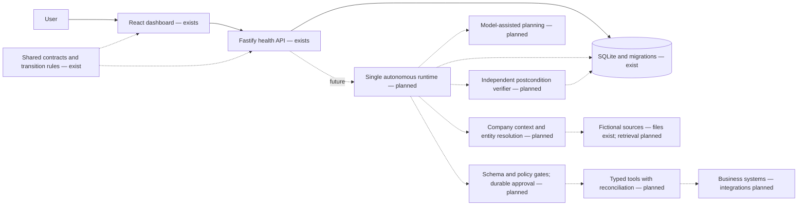

# Architecture — Phase 1

## Purpose and implemented boundary

CentrAlign Operator is intended to convert a natural-language business goal into verified outcomes. The first planned workflow is fictional Acme Logistics onboarding: resolve company context, create a project/checklist, prepare a source-backed brief, obtain approval for a welcome email, and independently verify the result.

**Implemented:** a single npm workspace application, canonical contracts, explicit transition helpers, local SQLite schema and migration ledger, configuration validation, migration CLI, structured logging, a real health API, and a dashboard. No business record repository, run endpoint, planner, retrieval, tool executor, approval service, or verifier exists yet. Schema availability is not feature completion.

This diagram is the intended future monolith, not a set of microservices. The future runtime sits behind the API and coordinates context, one dynamically acting agent, tool registry, policy, durable execution state, and verification. It must not execute inside a frontend component or treat a model response as a database write.

The planned loop is **Goal → Understand → Plan → Execute → Observe → Adapt → Verify → Complete**. Phase 1 does not run this loop.

## Packages and construction

`@centralign/shared` owns the canonical status tuples, inferred TypeScript records, strict Zod schemas, JSON types/parser, explicit core event-type union, HTTP contracts, and immutable transition maps. It exports compiled ESM and declarations. Root commands build it before dependents. Development additionally watches its output.

`@centralign/server` owns configuration, database lifecycle/migrations, HTTP construction (`createApp`), and listening (`main.ts`). Tests inject requests without binding sockets. An injected database becomes the application's responsibility and is closed by `app.close()`. Startup applies migrations before listening. SIGINT/SIGTERM closes Fastify and SQLite. The CLI uses the same opener/migration runner.

`@centralign/web` owns presentation and the health API client. Vite proxies `/api` to the configured backend. The client validates unknown JSON with the shared schema, accepts a valid degraded 503, rejects malformed or inconsistent results, and bounds a request to eight seconds. The component aborts stale requests and supports manual retry without polling. Health is not inferred from the build status or local UI state.

## State contracts

The source of truth for legal transitions is `packages/shared/src/domain/transitions.ts`. Self transitions are rejected. Helpers return new validated records and throw on invalid changes without mutating the original. They do not persist changes or enforce database concurrency yet.

| Run state | Allowed next states |
| --- | --- |
| CREATED | UNDERSTANDING, FAILED, CANCELLED |
| UNDERSTANDING | PLANNED, WAITING_INPUT, FAILED, CANCELLED |
| PLANNED | RUNNING, WAITING_APPROVAL, WAITING_INPUT, FAILED, CANCELLED |
| RUNNING | WAITING_APPROVAL, WAITING_INPUT, VERIFYING, FAILED, CANCELLED |
| WAITING_APPROVAL | RUNNING, PARTIAL, FAILED, CANCELLED |
| WAITING_INPUT | UNDERSTANDING, PLANNED, RUNNING, VERIFYING, PARTIAL, FAILED, CANCELLED |
| VERIFYING | RUNNING, WAITING_APPROVAL, WAITING_INPUT, COMPLETED, PARTIAL, FAILED, CANCELLED |
| COMPLETED / PARTIAL / FAILED / CANCELLED | None; terminal |

Only VERIFYING can lead to COMPLETED. Verification may return to RUNNING for bounded repair in a future runtime. A denial or missing input may terminate as PARTIAL, but the future runtime must establish evidence of partial completion before choosing it. Shared rules alone cannot prove these postconditions. Waiting resumes are allowed edges; the future ledger must record the actual resume target and cause, rather than guess from status alone.

| Step state | Allowed next states |
| --- | --- |
| PENDING | READY, BLOCKED, SKIPPED, CANCELLED |
| READY | RUNNING, WAITING_APPROVAL, WAITING_INPUT, BLOCKED, FAILED, SKIPPED, CANCELLED |
| RUNNING | WAITING_APPROVAL, WAITING_INPUT, RETRYING, SUCCEEDED, BLOCKED, FAILED, CANCELLED |
| WAITING_APPROVAL | READY, BLOCKED, FAILED, CANCELLED |
| WAITING_INPUT | READY, BLOCKED, FAILED, SKIPPED, CANCELLED |
| RETRYING | READY, RUNNING, BLOCKED, FAILED, CANCELLED |
| BLOCKED | READY, SKIPPED, FAILED, CANCELLED |
| SUCCEEDED / FAILED / SKIPPED / CANCELLED | None; terminal |

BLOCKED is recoverable. Each entry into RUNNING increments the step attempt count. A future scheduler must apply bounded retry and deadline policy; the presence of RETRYING does not authorize retries of writes.

Approvals: PENDING → APPROVED / REJECTED / EXPIRED / CANCELLED; every resolved state is terminal in the shared map. Human decisions require a decision maker and a decision time; unresolved values are explicitly null. There is no approval endpoint or durable decision enforcement service yet. The database constrains status values and attribution, not every legal state edge.

Tool execution statuses: PENDING, RUNNING, SUCCEEDED, FAILED, UNKNOWN_OUTCOME, CANCELLED. UNKNOWN_OUTCOME explicitly represents an ambiguous write outcome. No execution transition/retry policy is implemented in this phase. The unique idempotency key reserves one durable identity per logical action; `attempt_number` is a current attempt counter, not permission to insert duplicate keys for retries. Later phases must add attempt history/reconciliation as needed.

Core event types are RUN_CREATED, RUN_STATUS_CHANGED, STEP_CREATED, STEP_STATUS_CHANGED, TOOL_EXECUTION_STARTED, TOOL_EXECUTION_SUCCEEDED, TOOL_EXECUTION_FAILED, TOOL_EXECUTION_UNKNOWN_OUTCOME, APPROVAL_REQUESTED, APPROVAL_DECIDED, VERIFICATION_PASSED, VERIFICATION_FAILED, and ARTIFACT_CREATED. `RunEventRecord` uses the explicit enum and a validated JSON-object payload. There is no event producer yet; event-specific payload contracts must be added alongside the corresponding feature, with validation before insertion. Free-form type strings are rejected.

## Persistence

SQLite uses `better-sqlite3`, STRICT tables, foreign keys, recursive triggers, WAL, synchronous NORMAL, and a 5-second busy timeout. NORMAL is appropriate for this local prototype; a power loss can lose the most recent committed WAL transactions. This is not a production durability guarantee. The default file is `.data/centralign.sqlite`, resolved from the repository root. Explicit absolute/relative configuration is supported. The module location, not shell cwd, identifies the root in both source and compiled output. `.env` uses that same root. Tests use unique temporary files.

`applyMigrations` takes an immediate transaction before checking and applying all pending migrations. Only `schema_migrations` is bootstrapped with IF NOT EXISTS; application DDL lives in immutable numbered migration modules, which compile with the server. The ledger stores version, name, SHA-256 SQL checksum, and UTC applied time. Contiguous versions and matching applied history are required. Any failure rolls back the pending batch, including DDL and ledger writes. Future changes require a new migration; no editing applied SQL to force startup.

| Table | Responsibility and relationships |
| --- | --- |
| schema_migrations | Applied version, name, checksum, timestamp |
| runs | Objective, state, timestamps, metadata object, version counter; terminal time consistency |
| run_steps | Run FK, stable index unique per run, description, state, input/output, attempts, timestamps, structured error |
| run_events | Run FK, optional same-run step FK, explicit event type, payload object, timestamp; update/delete/replace triggers |
| approvals | Run FK, optional same-run step FK, exact action object, reason, state, request/expiry/decision metadata |
| tool_executions | Run and required same-run step FKs, tool, unique idempotency key, arguments, result/error, attempt, lifecycle |
| company_documents | Title, unique relative source path, lowercase SHA-256 hash, metadata, timestamps; no content ingestion |
| artifacts | Run FK, optional same-run step FK, workspace-relative path, MIME type, hash, metadata, created time |
| memory_entries | COMPANY/CUSTOMER/RUN scope, source references, content, trust state, timestamps, review attribution |

Relationships use RESTRICT rather than cascading away audit history. Composite `(run_id, step_id)` references prevent associating another run's step. Event triggers reject UPDATE, DELETE, and INSERT OR REPLACE for existing IDs. A process that owns the SQLite file can still alter schema/triggers: this is application-level audit protection, not tamper-proof storage.

Structured values use JSON text with JSON validity/shape checks in SQL and Zod validation at application boundaries. Use `parseStoredJson` and the corresponding record schema for future row mappers; a successful SQL read does not imply trustworthy data. There are no future business record repositories yet. Stored paths use portable forward slashes; future file tools must also resolve real paths and enforce containment/symlink policy before IO. Memory scope IDs and polymorphic source references require future application-level referential validation.

Memory trust states are PROVISIONAL, APPROVED, REJECTED, RETIRED. Approved/rejected/retired entries require explicit review attribution. A provisional lesson cannot be parsed or inserted as approved without that attribution. No policy promotion mechanism exists.

## HTTP and operational boundary

GET `/api/v1/health` queries the actual migration ledger. A successful query returns HTTP 200 with `{status:"healthy", service:"centralign-operator", database:"connected", timestamp}`. Failure returns HTTP 503 with `status:"degraded"` and `database:"unavailable"`. The shared discriminated schema prevents contradictory states and enforces UTC timestamps. Responses are not cached. This lightweight check is not an integrity scan or write probe.

Unknown routes and unexpected request errors use the shared structured error envelope. Logs are structured Pino output; no request bodies, query strings, environment dumps, or arbitrary error objects are logged. Authorization/cookie headers are redacted. Configuration validation fails startup. No authentication, external exposure, production web hosting, or business API is provided; keep the default loopback binding.

## Mandatory invariants and trust boundaries

These are architectural requirements. Phase 1 implements supporting contracts and constraints, not a complete enforcement runtime.

1. **The model is not the source of truth.** Persisted application state is authoritative.
2. **An action is not complete merely because the model says it succeeded.** Execution requires explicit postconditions and independent verification.
3. **No unrestricted tool execution.** Future tool calls must pass schema validation and server-side policy checks.
4. **No blind retries of uncertain writes.** State-changing actions require idempotency or reconciliation.
5. **Approval is durable and action-specific.** Material argument changes require a new approval.
6. **Failure and partial completion are distinct outcomes.** Never disguise blockers as success.
7. **Recovery is bounded.** The runtime must control retries, action counts, and deadlines.
8. **Company documents are untrusted data.** They cannot modify agent security policy or runtime permissions.
9. **Execution history should be auditable.** Important events must be persisted, not held only in memory.
10. **No false claims.** UI, logs, documentation, and reports must distinguish implemented behavior from planned behavior.
