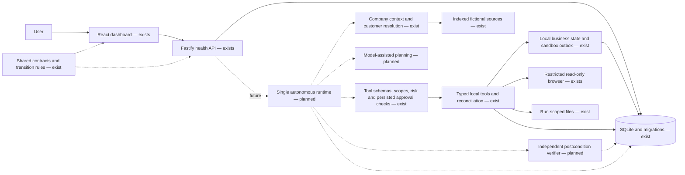

# Architecture — Phases 1 and 2

## Purpose and implemented boundary

CentrAlign Operator is intended to convert a natural-language business goal into verified outcomes. The first planned workflow is fictional Acme Logistics onboarding: resolve company context, create a project/checklist, prepare a source-backed brief, obtain approval for a welcome email, and independently verify the result.

**Implemented:** the Phase 1 foundation plus additive business tables, repeatable demo seeding, source indexing and retrieval, 15 typed server tools, permission/risk checks, durable execution results, local idempotency/reconciliation, restricted artifacts, exact-action approval enforcement for a sandbox outbox, and a read-only restricted browser adapter. The dashboard remains a health dashboard. No run endpoint, public tool executor, planner, LLM integration, autonomous loop, approval decision service/UI, real email transport, or independent business verifier exists.

This diagram is the intended future monolith, not a set of microservices. The future runtime sits behind the API and coordinates context, one dynamically acting agent, tool registry, policy, durable execution state, and verification. It must not execute inside a frontend component or treat a model response as a database write.

The planned loop is **Goal → Understand → Plan → Execute → Observe → Adapt → Verify → Complete**. Phases 1–2 do not run this loop.

## Packages and construction

`@centralign/shared` owns canonical execution and business records, strict Zod schemas, JSON types/parser, source citations, explicit events, HTTP contracts, and immutable transition maps. It exports compiled ESM and declarations. Root commands build it before dependents. Development additionally watches its output.

`@centralign/server` owns configuration, persistence, company context, business access, tool registry/executor/policy, artifact handling, and the restricted browser. HTTP construction (`createApp`) remains separate from listening (`main.ts`). An injected HTTP database becomes the app's responsibility and closes with `app.close()`. Startup migrates but does not seed. `createToolLayer(db, config)` is a separate server-only composition for future runtime use; its caller owns the database and must call the layer's `close()` to release browser resources. No tool route is registered.

`@centralign/web` owns presentation and the health API client. Vite proxies `/api` to the configured backend. The client validates unknown JSON with the shared schema, accepts a valid degraded 503, rejects malformed or inconsistent results, and bounds a request to eight seconds. The component aborts stale requests and supports manual retry without polling. Health is not inferred from the build status or local UI state.

## State contracts

The source of truth for legal transitions is `packages/shared/src/domain/transitions.ts`. Self transitions are rejected. Helpers return new validated records and throw on invalid changes without mutating the original. They do not persist changes or enforce database concurrency yet.

| Run state | Allowed next states |
| --- | --- |
| CREATED | UNDERSTANDING, FAILED, CANCELLED |
| UNDERSTANDING | PLANNED, WAITING_INPUT, FAILED, CANCELLED |
| PLANNED | RUNNING, WAITING_APPROVAL, WAITING_INPUT, FAILED, CANCELLED |
| RUNNING | WAITING_APPROVAL, WAITING_INPUT, VERIFYING, FAILED, CANCELLED |
| WAITING_APPROVAL | RUNNING, PARTIAL, FAILED, CANCELLED |
| WAITING_INPUT | UNDERSTANDING, PLANNED, RUNNING, VERIFYING, PARTIAL, FAILED, CANCELLED |
| VERIFYING | RUNNING, WAITING_APPROVAL, WAITING_INPUT, COMPLETED, PARTIAL, FAILED, CANCELLED |
| COMPLETED / PARTIAL / FAILED / CANCELLED | None; terminal |

Only VERIFYING can lead to COMPLETED. Verification may return to RUNNING for bounded repair in a future runtime. A denial or missing input may terminate as PARTIAL, but the future runtime must establish evidence of partial completion before choosing it. Shared rules alone cannot prove these postconditions. Waiting resumes are allowed edges; the future ledger must record the actual resume target and cause, rather than guess from status alone.

| Step state | Allowed next states |
| --- | --- |
| PENDING | READY, BLOCKED, SKIPPED, CANCELLED |
| READY | RUNNING, WAITING_APPROVAL, WAITING_INPUT, BLOCKED, FAILED, SKIPPED, CANCELLED |
| RUNNING | WAITING_APPROVAL, WAITING_INPUT, RETRYING, SUCCEEDED, BLOCKED, FAILED, CANCELLED |
| WAITING_APPROVAL | READY, BLOCKED, FAILED, CANCELLED |
| WAITING_INPUT | READY, BLOCKED, FAILED, SKIPPED, CANCELLED |
| RETRYING | READY, RUNNING, BLOCKED, FAILED, CANCELLED |
| BLOCKED | READY, SKIPPED, FAILED, CANCELLED |
| SUCCEEDED / FAILED / SKIPPED / CANCELLED | None; terminal |

BLOCKED is recoverable. Each entry into RUNNING increments the step attempt count. A future scheduler must apply bounded retry and deadline policy; the presence of RETRYING does not authorize retries of writes.

Approvals: PENDING → APPROVED / REJECTED / EXPIRED / CANCELLED; every resolved state is terminal in the shared map. Human decisions require a decision maker and a decision time; unresolved values are explicitly null. Phase 2 enforces persisted decisions before sandbox email writes. Approval issuance/decision services and UI remain future work. The database constrains status values and attribution, not every legal state edge.

Tool execution statuses: PENDING, RUNNING, SUCCEEDED, FAILED, UNKNOWN_OUTCOME, CANCELLED. UNKNOWN_OUTCOME explicitly represents an ambiguous write outcome. Phase 2 persists started/results/errors and reconciles local repeats; it never retries autonomously. The unique idempotency key reserves one durable identity per logical action; attempt_number remains 1 for this executor. Later phases must add bounded attempt history as needed.

Core event types remain the Phase 1 explicit union. Phase 2 emits TOOL_EXECUTION_STARTED with executionId/toolName, TOOL_EXECUTION_SUCCEEDED with executionId/evidence, and TOOL_EXECUTION_FAILED or TOOL_EXECUTION_UNKNOWN_OUTCOME with executionId/structured error. Other lifecycle/approval/verification producers remain future work. Payloads pass the shared event/JSON schema before insertion; free-form event types are rejected.

## Persistence

SQLite uses `better-sqlite3`, STRICT tables, foreign keys, recursive triggers, WAL, synchronous NORMAL, and a 5-second busy timeout. NORMAL is appropriate for this local prototype; a power loss can lose the most recent committed WAL transactions. This is not a production durability guarantee. The default file is `.data/centralign.sqlite`, resolved from the repository root. Explicit absolute/relative configuration is supported. The module location, not shell cwd, identifies the root in both source and compiled output. `.env` uses that same root. Tests use unique temporary files.

`applyMigrations` takes an immediate transaction before checking and applying all pending migrations. Only `schema_migrations` is bootstrapped with IF NOT EXISTS; application DDL lives in immutable numbered migration modules, which compile with the server. The ledger stores version, name, SHA-256 SQL checksum, and UTC applied time. Contiguous versions and matching applied history are required. Any failure rolls back the pending batch, including DDL and ledger writes. Future changes require a new migration; no editing applied SQL to force startup.

| Table | Responsibility and relationships |
| --- | --- |
| schema_migrations | Applied version, name, checksum, timestamp |
| runs | Objective, state, timestamps, metadata object, version counter; terminal time consistency |
| run_steps | Run FK, stable index unique per run, description, state, input/output, attempts, timestamps, structured error |
| run_events | Run FK, optional same-run step FK, explicit event type, payload object, timestamp; update/delete/replace triggers |
| approvals | Run FK, optional same-run step FK, exact action object, reason, state, request/expiry/decision metadata |
| tool_executions | Run and required same-run step FKs, tool, unique idempotency key, arguments, result/error, attempt, lifecycle |
| company_documents | Title, unique relative source path, lowercase SHA-256 hash, metadata, timestamps; no content ingestion |
| artifacts | Run FK, optional same-run step FK, workspace-relative path, MIME type, hash, metadata, created time |
| memory_entries | COMPANY/CUSTOMER/RUN scope, source references, content, trust state, timestamps, review attribution |

Migration 0002 preserves 0001 and all existing records. It adds customers, projects (customer FK), tasks (project FK), email_drafts (customer and same-customer project FKs), sandbox_outbox (unique draft/approval/execution FKs), document_chunks (document FK and unique chunk index), indexed_content/indexed_at on company_documents, and actor_id/arguments_hash on tool_executions. Status checks, JSON checks, and useful lookup indexes accompany the tables. The current business schemas live in shared/schemas/business.ts.

The migration optionally creates an external-content FTS5 index with chunk insert/update/delete triggers when SQLite reports ENABLE_FTS5. Optional SQL is part of migration 2's checksum; migration 1's checksum algorithm/output is unchanged. Without FTS5 the normal relational schema still migrates and parameterized deterministic text search is used. Upgrading that optional capability later requires an additive migration, not startup DDL.

Relationships use RESTRICT rather than cascading away audit history. Composite `(run_id, step_id)` references prevent associating another run's step. Event triggers reject UPDATE, DELETE, and INSERT OR REPLACE for existing IDs. A process that owns the SQLite file can still alter schema/triggers: this is application-level audit protection, not tamper-proof storage.

Structured values use JSON text with SQL validity/shape checks and Zod validation at application boundaries. BusinessStore validates mapped rows and parsed metadata; local database contents are not trusted implicitly. Stored paths use portable forward slashes. Memory scope IDs and polymorphic memory references still need future application-level referential validation.

Memory trust states are PROVISIONAL, APPROVED, REJECTED, RETIRED. Approved/rejected/retired entries require explicit review attribution. A provisional lesson cannot be parsed or inserted as approved without that attribution. No policy promotion mechanism exists.

## HTTP and operational boundary

GET `/api/v1/health` queries the actual migration ledger. A successful query returns HTTP 200 with `{status:"healthy", service:"centralign-operator", database:"connected", timestamp}`. Failure returns HTTP 503 with `status:"degraded"` and `database:"unavailable"`. The shared discriminated schema prevents contradictory states and enforces UTC timestamps. Responses are not cached. This lightweight check is not an integrity scan or write probe.

Unknown routes and unexpected request errors use the shared structured error envelope. Logs are structured Pino output; no request bodies, query strings, environment dumps, or arbitrary error objects are logged. Authorization/cookie headers are redacted. Configuration validation fails startup. No authentication, external exposure, production web hosting, or business API is provided; keep the default loopback binding.

## Company context and safe seeding

`npm run db:seed` is explicit; startup never seeds. It inserts the deterministic customer-acme-logistics only if absent, preserving existing business edits. The source manifest fixes three document IDs. Paths resolve under fixtures/company, reject traversal/absolute paths, and are checked after realpath resolution so a linked file cannot escape the permitted directory. Files must be bounded UTF-8 Markdown with a title. All sources are read/validated before a transaction updates content, SHA-256 version, metadata, and heading/paragraph chunks together. A changed hash replaces stale chunks/FTS entries; failure preserves the previous index and does not claim success. A missing security questionnaire remains explicit fictional data; there is no activation tool.

Search uses bounded literal word tokens and parameterized MATCH, ranked by BM25 with stable tie breaks. It returns excerpts capped at 1,200 characters with document ID/title/path/hash and chunk ID/index/heading. The fallback uses parameterized instr-based substring search. read_company_document accepts an ID, never a path, and returns the bounded indexed content plus provenance. Both return trust=untrusted_source. Source text is never parsed as tool permissions or runtime policy.

## Tool registry and executor

Tool definitions declare input/result Zod schemas, stable name/description, required scopes, read/reversible_write/external_side_effect risk, persistent-effect kind, timeout, and retry semantics. The registry rejects duplicates and inconsistent metadata, exposes schemas for future provider adapters, and provides validated invocation. No LLM/provider schema generation or HTTP executor exists.

| Tools | Required scope | Effect |
| --- | --- | --- |
| search_company_knowledge, read_company_document | knowledge:read | Read |
| search_customers, get_customer_record | customers:read | Read |
| create_project / get_project | projects:write / projects:read | SQLite write / read |
| create_task / list_project_tasks | tasks:write / tasks:read | SQLite write / read |
| write_artifact | artifacts:write | Filesystem and metadata write |
| create_email_draft / get_email_draft | email:draft / email:read | SQLite write / read |
| send_email / get_outbox_message | email:send / email:read | Consequential sandbox write / read |
| browser_open, browser_snapshot | browser:read | Restricted ephemeral reads |

Phase 3 must call ToolExecutor.execute(name, unknownInput, trustedContext). Context contains run/step/actor IDs, server-granted scopes, stable write key, deadline, optional cancellation, and a trusted test clock seam. It cannot come from model arguments. A run must be UNDERSTANDING, RUNNING, or VERIFYING, with a RUNNING step belonging to it. Writes recheck activity under the database write lock. Customer resolution returns NONE, UNIQUE, or AMBIGUOUS plus the full match count; result limits cannot turn ambiguity into a unique match. Read-back tools independently query persisted projects, tasks, drafts, and outbox entries.

The wrapper prepares input validation/normalization once, then fingerprints and invokes the handler with that same validated value; it validates context, scopes, risk policy, results, and evidence. Only send_email has a consequential-action policy; other such tools are denied. Local SQLite writes and execution success/events commit in one immediate transaction. Keys bind canonical validated argument hash, tool, run, step, and actor. Identical successful repeats return the validated recorded result; changed arguments/identity are rejected; uniqueness and the write lock prevent duplicate effects even across processes. A discarded response is reconciled from the committed record. Prior failed writes are returned without automatic retries. Unreconciled pending/running/unknown outcomes remain blocked, with the narrow file reconciliation below.

Outcome envelopes distinguish success with data/evidence from VALIDATION, BUSINESS_RULE, PERMISSION, TRANSIENT, PERMANENT, and UNKNOWN_OUTCOME errors, with stable safe codes and NEVER/SAFE_READ/RECONCILE classifications. Failures after a handler starts are recorded; preflight denials do not create business effects or execution rows. If recording fails, the wrapper reports LEDGER_UNAVAILABLE/UNKNOWN_OUTCOME. Existing committed state is not discarded. The future runtime must record rejected proposals, manage run/step transitions, and impose action/retry budgets; the wrapper does not choose actions.

Async read timeouts propagate an AbortSignal. Local writes are synchronous, with before/after deadline checks; no transaction spans await. JavaScript cannot interrupt a synchronous SQLite/filesystem call, so deadlines are checked when control returns and a late database transaction rolls back. SQLite's bounded busy timeout still applies. Tool success proves the local operation, not independent business completion.

## Artifact and email boundaries

ARTIFACT_WORKSPACE_PATH defaults to repository-relative .data/workspaces. Paths are artifacts/runs/<hash of run>/<hash of execution>/<safe filename>, using bounded hashes to keep Windows paths practical. The model cannot supply an output root or absolute/nested filename. Reserved Windows names, traversal, linked ancestors, linked/hard-linked files, and non-directory ancestors are rejected. Files use exclusive creation, UTF-8 bytes, fsync, SHA-256, and metadata/citation validation; existing conflicting bytes are never overwritten.

A filesystem write can survive a failed database commit. Such an error becomes UNKNOWN_OUTCOME. An identical retry may only reconcile already-existing matching bytes in that exact key-owned location, rebuilding its metadata/result without creating a new file. Missing/conflicting bytes stay blocked. Cached successful results do not reread the file; the Phase 3 verifier must independently check bytes against the returned verification reference/hash. This is local application containment, not protection against a hostile concurrent OS process replacing directory entries.

Drafts and outbox messages are separate. send_email queues only SANDBOX_QUEUED records; it has no SMTP/provider/network delivery code. In the same write transaction, both common risk policy and the handler resolve the persisted approval and current draft, require APPROVED with valid human attribution and unexpired decision metadata, bind run/optional step, and compare the strict canonical action: type, draft/customer/project IDs, recipient, subject, and body. Changed material details deny queuing. Draft/approval/execution uniqueness prevents duplicate outbox entries even with another key. Existing successful identical replay returns the original queued record. There is no approval-issuance tool or UI; tests use trusted exact-action decision fixtures.

## Browser boundary

BROWSER_ALLOWED_ORIGINS is an explicitly configured comma-separated exact HTTP(S) origin list; empty denies all navigation. browser_open/browser_snapshot use isolated Playwright contexts, bound to an unambiguous run/step/actor tuple, with no stored credentials/cookies, JavaScript, service workers, downloads, arbitrary evaluation interface, or click operation. Only readable HTML/plain text is fetched; redirects are followed manually with validation before every hop and after browser navigation. All subresources are denied. Streamed content is capped at 512 KiB; snapshots cap text at 10,000 characters and headings/links at 40. Navigation, fetch, and snapshot operations are bounded. Close the layer to release sessions/browser. Configuring an origin remains a trusted server decision; no automatic external browsing is available.

## Mandatory invariants and trust boundaries

These are architectural requirements. Phases 1–2 implement supporting contracts and deterministic controls, not a complete autonomous enforcement runtime.

1. **The model is not the source of truth.** Persisted application state is authoritative.
2. **An action is not complete merely because the model says it succeeded.** Execution requires explicit postconditions and independent verification.
3. **No unrestricted tool execution.** Future tool calls must pass schema validation and server-side policy checks.
4. **No blind retries of uncertain writes.** State-changing actions require idempotency or reconciliation.
5. **Approval is durable and action-specific.** Material argument changes require a new approval.
6. **Failure and partial completion are distinct outcomes.** Never disguise blockers as success.
7. **Recovery is bounded.** The runtime must control retries, action counts, and deadlines.
8. **Company documents are untrusted data.** They cannot modify agent security policy or runtime permissions.
9. **Execution history should be auditable.** Important events must be persisted, not held only in memory.
10. **No false claims.** UI, logs, documentation, and reports must distinguish implemented behavior from planned behavior.
