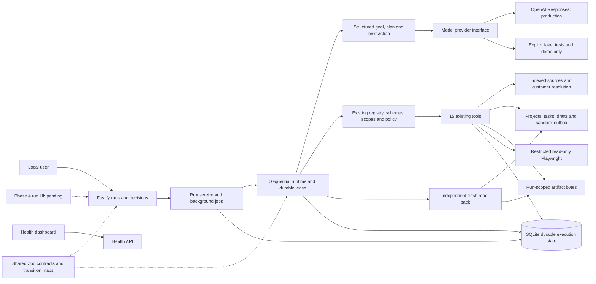

# Architecture — Phases 1–3

CentrAlign Operator implements **Goal → Understand → Plan → Execute → Observe → Adapt → Verify → Complete** behind deterministic controls. The React screen remains a health dashboard. Run controls, timelines, approval buttons and artifact exploration remain Phase 4 work. Email means a local SQLite sandbox outbox, never network delivery.

## Construction and model decisions

This is one TypeScript monolith with three npm workspaces and one lockfile. Shared ESM contracts build before server/web. createApp constructs Fastify separately from listening, owns its database, starts recovery on readiness, and closes jobs/browser/SQLite on shutdown. Startup migrates but never seeds. createToolLayer remains reusable and server-only; its caller owns SQLite and closes browser resources.

agent/contracts.ts defines provider/execution ports, faults, budgets and bounds. openai-provider.ts uses the official SDK Responses API with strict JSON-schema text output, store:false, bounded response bytes, cancellation, timeout and no SDK automatic retries. It is the application default. Missing credentials keep startup/health available and reject live submission with HTTP 503 before inserting a run. FakeModelProvider is explicitly injected only by tests or agent:demo.

model-provider.ts validates every response again with Zod and semantic checks. One structured repair and at most two transient retries consume the persisted global recovery budget. Timeout/cancellation wraps even a provider ignoring its signal. Permanent/configuration errors do not retry. Model-call records contain phase, status and hashes, never raw reasoning or provider error bodies.

planner.ts checks requested outcome coverage, scope compatibility, source requirements and plan coverage. The exact original objective is separate from the immutable structured goal. Required deliverables have stable IDs, categories, counts and source requirements. Plans contain milestones, prerequisites and explicit blockers; revisions cannot remove a required outcome. Activation readiness is separate and accepted only when requested.

The production runtime asks for exactly one next tool, question or completion proposal from current observations. It has no fixed onboarding tool array. Plans guide decisions without executing themselves. Valid revised plans are persisted; errors, duplicates and failed verification feed bounded adaptation. The explicit test/demo model is scripted and labeled accordingly.

runtime.ts owns canonical state transitions, sequencing, preconditions, policy gates, execution and completion. run-store.ts persists goals, revisions, questions, counters, leases and checks. run-service.ts coordinates HTTP methods, per-process single-flight, durable decisions and recovery. A resume arriving during worker exit is retained for processing after that job.

## Durable authority

SQLite uses better-sqlite3 STRICT tables, foreign keys, recursive triggers, WAL, synchronous NORMAL and a five-second busy timeout. Migration application takes an immediate lock and validates contiguous versions/names/SHA-256 checksums. Migrations 0001 and 0002 remain unchanged. Migration 0003 adds:

| Table | Responsibility |
| --- | --- |
| agent_runs | Goal, actor/scopes, customer binding, budgets/counters, absolute deadline, cancellation, lease, feedback and final result |
| agent_plan_revisions | Ordered validated plan history |
| agent_deliverables | Stable required outcome specifications |
| agent_steps | Tool/arguments, semantic operation hash/key, execution/approval association and blocker |
| agent_step_deliverables | Same-run many-to-many outcome associations |
| agent_questions | Fingerprinted proposal, choices, status and attributed human answer |
| agent_verifications | Expected/observed checks and evidence history |
| agent_model_calls | Phase/lifecycle, request/response hashes and safe error code |

Existing runs, steps, approvals, artifacts and tool_executions remain authoritative. Migration 0003 transactionally rebuilds the event representation to expand its explicit type CHECK and add a monotonic sequence, preserving every old event's fields/ID/order and restoring append-only triggers and same-run FKs. Cursor pages use sequence, never timestamps. cursor is the last returned sequence (or supplied cursor on an empty page); nextCursor indicates another page. Retain cursor to poll later.

Run transitions use shared pure transition rules and version compare-and-swap inside immediate transactions. Only VERIFYING enters COMPLETED; terminal runs cannot resume. Each entry into RUNNING increments the step attempt count. A durable lease with claim/heartbeat/expiry and owner checks protects multiple services/connections. The executor rechecks the trusted authority callback inside write transactions. Lease loss stops stale execution; process single-flight is not the correctness boundary.

## Existing tool and trust boundary

The registry still contains exactly 15 tools: knowledge search/read, customer search/read, project create/read, task create/list, artifact write, draft create/read, sandbox send/read, browser open/snapshot. No generic executor route or second registry exists. Existing tool metadata, schemas, risk policy, result schemas and ledger govern all invocations.

Server context supplies run, step, actor, request-derived scopes, key, deadline, signal, clock and lease fence. Model arguments cannot grant scopes, approve an action, choose decision identity or configure the workspace. A send candidate includes only a discovered draft ID; trusted code issues and attaches its approval ID. Business writes require resolved customer identity and observed company sources; onboarding requires both SOP and security policy. Zero/multiple customer matches pause for an explicit choice. Even a unique record must match an entity named in the original request or require confirmation.

Documents, browser text, tool output and human-answer text remain untrusted. They cannot enlarge permissions or replace required goals. Credentials and the configured key are rejected in objective/model control content and redacted from context. HTTP logs omit request bodies/query strings and redact authorization/cookies. The default decision maker is fixed server-side local-user; multiuser authentication is pending.

Context is capped at 64 KiB, recent observations at 4 KiB, compact facts at 1.2 KiB, model candidates at 64 KiB, provider transport at 1 MiB, runtime artifacts at 32 KiB and draft bodies at 10,000 characters. Context retains goal/plan, original request, discovered IDs, source hashes/chunks, recent results, human answers and remaining budgets. SQLite keeps full tool history. No chain-of-thought is requested or stored.

## Human pauses and cancellation

Before a send, the runtime persists the exact canonical action (draft/customer/project IDs, recipient, subject, body), pending approval and WAITING_APPROVAL run/step. No outbox effect occurs yet. Decisions validate run/step/pending state/expiry and persist human identity/time/note. Identical repeats succeed; conflicting decisions return 409. The actual tool policy rereads the draft and approval. Changed material details invalidate authorization. Rejection terminates with truthful PARTIAL/FAILED; the model cannot bypass it with another proposal.

Questions persist specific IDs, reason/topic and observed choices. Answers target the pending question; customer resolution requires an explicit existing choice. Free text cannot establish a write's success. Reconciliation questions require a terminal authoritative execution record. Waiting approvals/questions survive restart unchanged and cause no new model/tool activity until resolved.

Cancellation persists intent and aborts active model/read work. It prevents new actions after observation, preserves/verifies committed effects and reports CANCELLED. Unknown write outcomes keep cancellation waiting for reconciliation. Shutdown aborts cooperative work without setting cancellation and leaves resumable state.

## Recovery and idempotency

Safe transient reads may retry twice with capped jittered backoff within shared recovery/tool/deadline budgets. Permission, validation and permanent failures are not automatically retried. Repair, transient retry, recovery and reconciliation consume persisted limits; model/tool calls and replans have separate limits. The absolute deadline survives restart.

Mutations use a run-scoped hash of the logical operation plus canonical normalized arguments. A repeated model proposal reuses the original step and evidence without another effect; changed material arguments have distinct identity. The existing tool key additionally binds run, step, actor, tool and argument hash. Synchronous SQLite writes commit effect, validated result and audit events together; no transaction crosses await.

Recovery reconstructs committed results when a response was lost or step success was not saved, then freshly verifies. Verified steps are not rerun. Interrupted safe reads may restart within budget; persisted permanent failures remain failed. A SQLite mutation without a ledger is uncommitted because its effect/result share a transaction. Unknown file writes use only the existing executor's matching-owned-byte reconciliation. Missing/conflicting/ambiguous outcomes pause; no blind write replay or file recreation occurs.

## Independent completion

verifier.ts independently reads rows and files. Projects/tasks/drafts must match expected fields, customer/project associations and execution-derived IDs. Sends require the exact approved action, draft, queued message and exactly one outbox record. Artifacts require same run/step, confined unlinked path, actual bytes/size/hash/MIME, expected content, current document/chunk provenance and citation text. Missing questionnaire status must remain visible.

Every mutation passes verification before its step becomes SUCCEEDED. Goal verification repeats fresh checks for every required outcome, counts distinct evidence, and rejects completion with pending human decisions. Failed checks trigger bounded adaptation. COMPLETED requires all required checks; PARTIAL requires meaningful verified required outcomes; FAILED establishes none. Final results distinguish verified, outstanding, unverified and never-executed work. Completed materials do not establish activation readiness; explicit readiness requires READY/ACTIVE, questionnaire received and security review approved.

## Preserved boundaries and limits

Explicit seed/index refresh remains repeatable and transactional, preserving business edits, source hashes/chunks, optional FTS5 and deterministic fallback. Artifacts retain deterministic scoped paths, exclusive creation, fsync, link checks and narrow reconciliation. Files and SQLite cannot commit atomically; hostile OS directory replacement is outside the local trust model.

Playwright defaults to deny, permits configured exact HTTP(S) origins, validates redirects before requests, disables JavaScript/downloads/service workers/subresources and exposes bounded readable text. Sessions bind run/actor across sequential steps. No clicks or arbitrary evaluation tool exists. Startup/context creation check already-fired deadline signals as well as navigation timeouts.

SQLite NORMAL is not a power-loss guarantee, and native synchronous work cannot be forcibly interrupted. Filesystem/SQLite ownership is trusted. External exactly-once execution, real integrations/delivery, authenticated identity, production scheduling/deployment and Phase 4 UI remain pending. Actual model quality/cost/availability require a live credentialed evaluation; deterministic tests cannot establish those properties.
